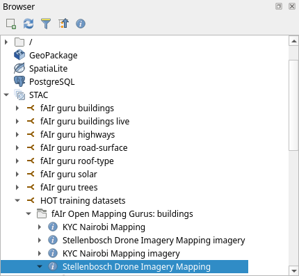
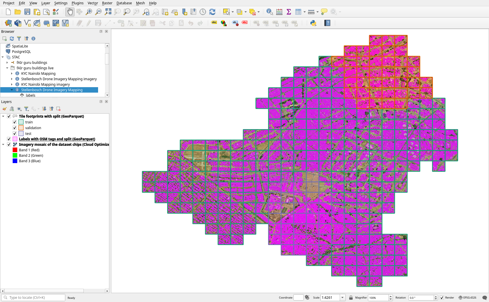
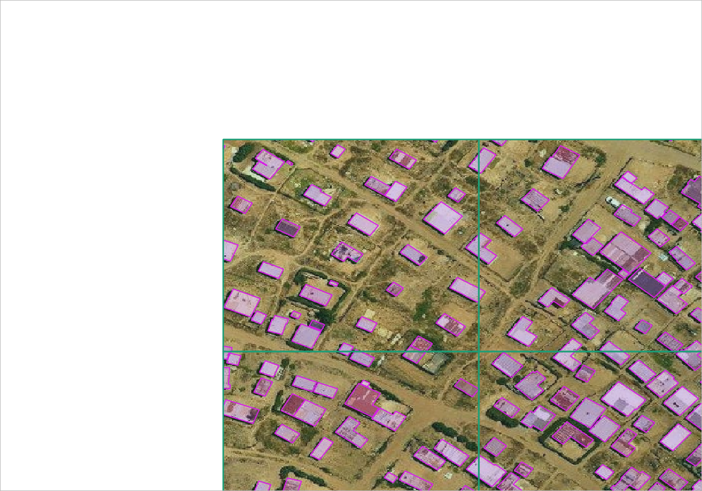
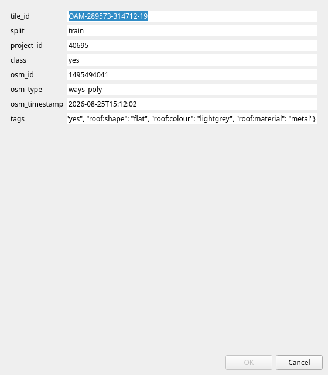
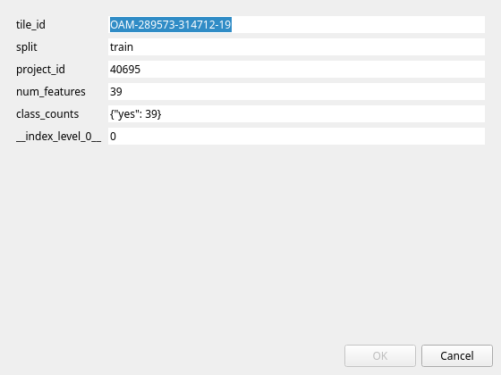
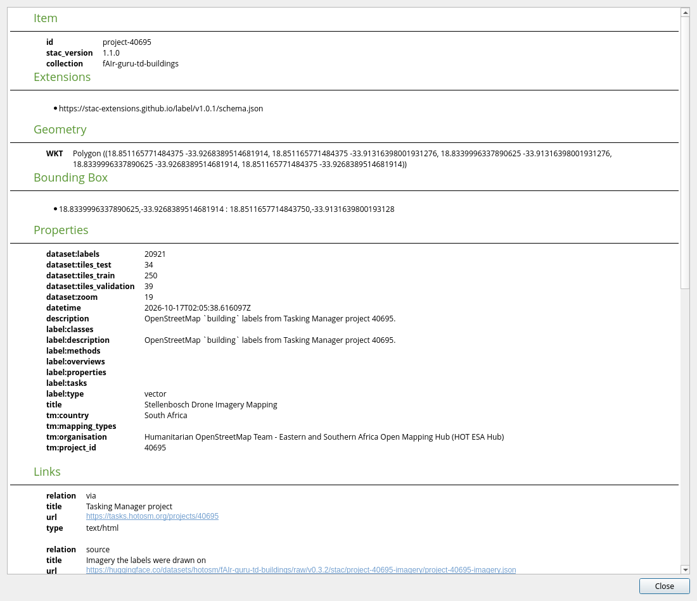

# Inspect in QGIS

## Connect

1. In the **Browser** panel, right-click **STAC** and choose **New STAC Connection**.
2. Enter the root catalogue URL:

    ```text
    https://huggingface.co/datasets/hotosm/fAIr-guru-stac/raw/main/catalog.json
    ```

3. Expand a dataset. Each Tasking Manager project has a labels item and an imagery item.



## Load a project

Drag the imagery item onto the map. From QGIS 4.0, dragging the labels item adds the
GeoParquet labels and tiles
([source](https://github.com/qgis/QGIS/blob/release-4_0/src/core/stac/qgsstacasset.cpp)). In
QGIS 3.44, add them with **Layer > Add Layer > Add Vector Layer**, **Protocol: HTTP(S)**, and
the asset URL
([source](https://github.com/qgis/QGIS/blob/release-3_44/src/core/stac/qgsstacasset.cpp)).

## Show the splits

In the tiles layer's **Symbology**, choose **Categorized** by `split` and **Classify**.





## Read the attributes

**Identify Features** on a label shows its tile, split, project, class, OSM id and tags:



A tile shows its split, label count and classes:



**Details** on an item shows its STAC metadata. QGIS 3.44 leaves list fields such as
`label:classes` blank there.


