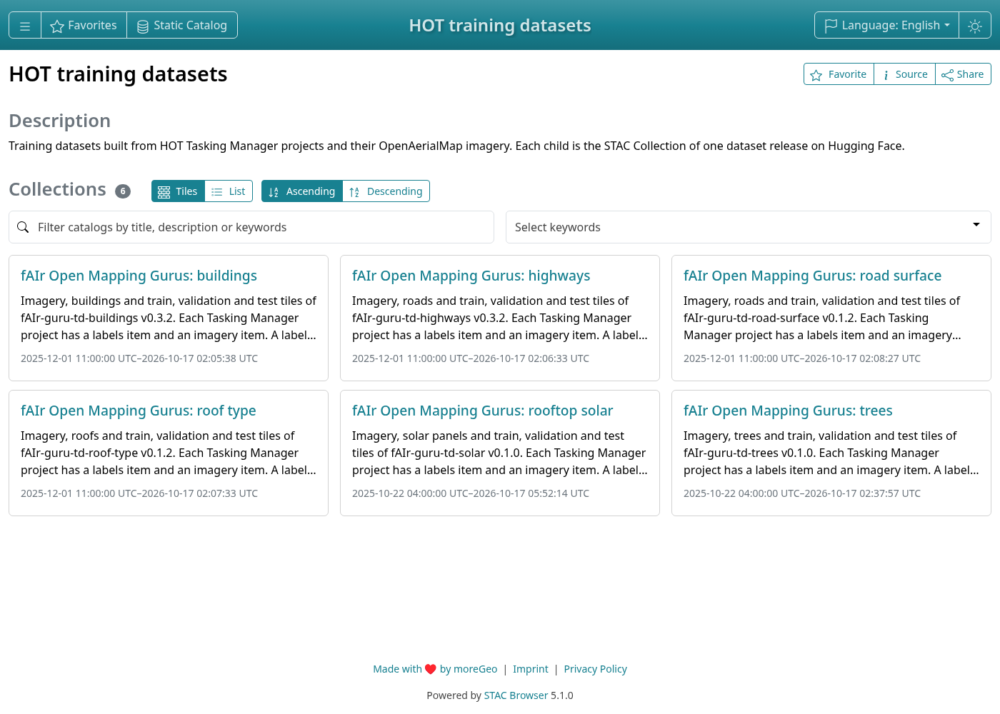
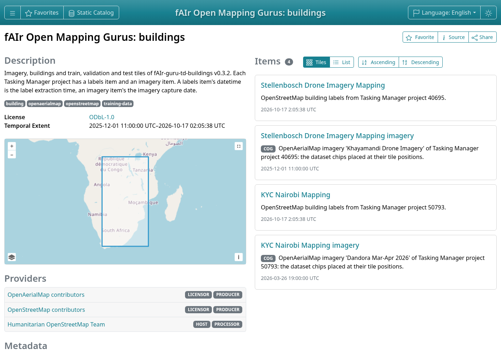
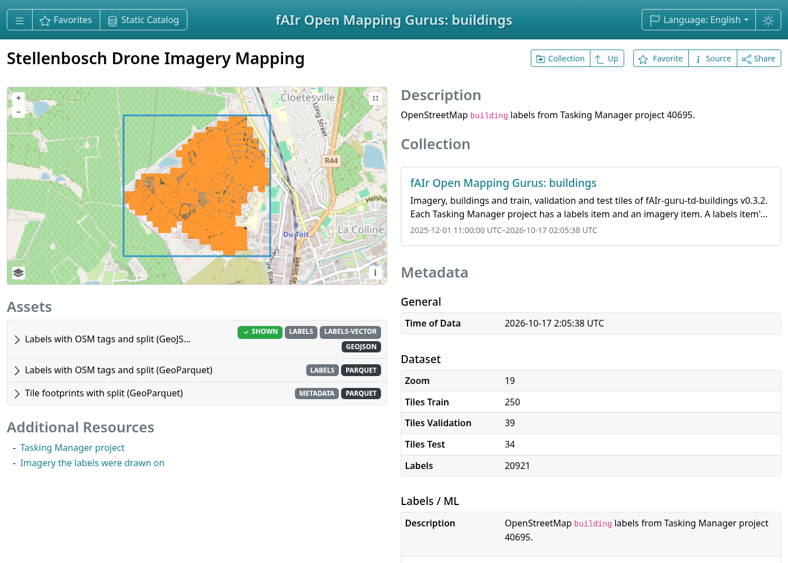

# Browse with STAC Browser

Paste this URL into [STAC Browser](https://radiantearth.github.io/stac-browser/) and choose
**Load**:

```text
https://huggingface.co/datasets/hotosm/fAIr-guru-stac/raw/main/catalog.json
```

It lists one release of each dataset. A single release opens from its own collection URL, such
as `https://huggingface.co/datasets/hotosm/fAIr-guru-td-buildings/raw/v0.3.2/stac/collection.json`.





## A project

The labels item shows the labels over the imagery, class counts, tiles per split and the Tasking
Manager project. The imagery item shows the capture date and pixel size
(`raster:spatial_resolution`).



Large label files, such as the 120,000 trees of project 50661, take a while to draw.

## Assets

The labels item holds the labels (GeoJSON and GeoParquet) and the tile footprints with their
split (GeoParquet). **Open in geoparquet.info** shows a GeoParquet file.
To colour tiles by split, use [QGIS](qgis.md).


